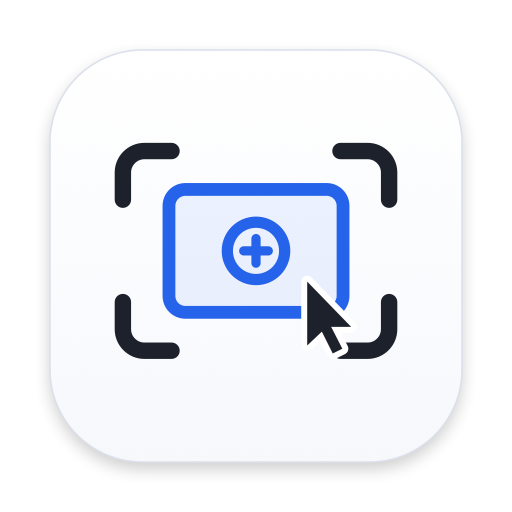

# Zoom Ke Mouse

<p align="center">
  
</p>

Aplikasi perekam layar macOS dengan fitur auto-zoom mengikuti posisi dan klik kursor secara real-time.

- **Versi:** `1.0.0`
- **Bundle Identifier:** `com.cutefishaep.zoomkmouse`
- **Target OS:** macOS 13.0 (Ventura) atau lebih baru

---

## Fitur

- **Perekaman Layar & Jendela Aplikasi:** Mendukung mode rekam layar penuh (`Selayar`) maupun jendela aplikasi tertentu (`Aplikasi`).
- **Auto-Zoom pada Klik Mouse:** Kamera otomatis melakukan zoom ke titik klik kursor dan kembali ke ukuran normal setelah durasi tahan yang ditentukan.
- **Dua Mode Zoom:**
  - `Bingkai Zoom`: Seluruh bingkai layar ikut diperbesar.
  - `Isi Zoom`: Konten layar diperbesar di dalam bingkai tetap.
- **Kustomisasi Kanvas & Background:** Mendukung wallpaper macOS aktif, preset gradasi, warna solid, atau gambar kustom, lengkap dengan pengaturan padding, corner radius, dan inset border.
- **Drop Shadow Sisi Luar:** Bayangan dihitung hanya pada keempat sisi luar bingkai tanpa merender area tengah layar untuk menjaga beban GPU tetap ringan.
- **Kursor & Efek Klik:** Pilihan gaya kursor vector (`Panah macOS`, `Lingkaran`, `Crosshair`) serta efek *ripple* untuk klik kiri dan klik kanan.
- **Penyimpanan Pengaturan Otomatis:** Seluruh konfigurasi pengguna disimpan otomatis menggunakan `UserDefaults`.
- **Kompatibilitas GPU & APU (termasuk `NootedRed.kext`):** Menggunakan komposisi shader Metal (`MTLRenderPipelineState`) dan encoder `Apple ProRes 422 LT` (`.mov`) agar perekaman 1080p tetap berjalan lancar pada perangkat tanpa encoder H.264 hardware.

---

## Cara Build dari Source

Pastikan **Xcode Command Line Tools** sudah terpasang di macOS:

```bash
chmod +x build_app.sh
./build_app.sh
```

Hasil build akan tersedia di `./ZoomKeMouse.app`. Untuk menjalankan aplikasi:

```bash
open ZoomKeMouse.app
```

Hasil rekaman video akan tersimpan secara otomatis di folder:

```text
~/Movies/ZoomKeMouse/
```

---

## Izin Sistem (macOS Permissions)

Saat pertama kali dijalankan, aplikasi membutuhkan izin **Screen Recording**:
1. Buka **System Settings → Privacy & Security → Screen Recording**.
2. Aktifkan izin untuk **Zoom Ke Mouse**.

---

## Kontributor

Lihat [CONTRIBUTORS.md](CONTRIBUTORS.md).

## Lisensi

Proyek ini dilisensikan di bawah **[Creative Commons Attribution-ShareAlike 4.0 International (CC BY-SA 4.0)](LICENSE)**:
- **Attribution (BY):** Wajib mencantumkan kredit ke pembuat asli (**Wahyu Septiaji / `@cutefishaep`**).
- **ShareAlike (SA):** Turunan atau modifikasi wajib tetap menggunakan lisensi **CC BY-SA 4.0** (tidak boleh diubah menjadi lisensi tertutup atau lisensi lain).

